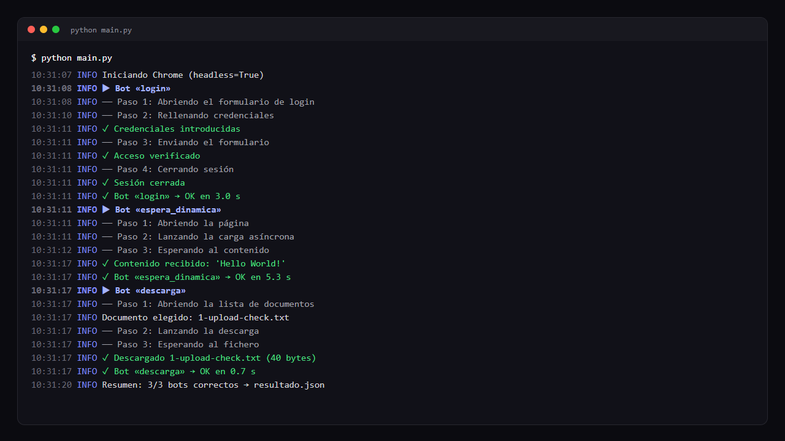

# rpa-demo-selenium

Demo de automatización web con **Python y Selenium**: tres bots que se ejecutan contra
un sitio de pruebas público ([the-internet.herokuapp.com](https://the-internet.herokuapp.com)),
con la estructura que uso en automatizaciones reales: excepciones tipadas, logs que permiten
diagnosticar sin abrir el navegador y captura de pantalla automática ante cualquier fallo.

> Proyecto de demostración. Solo interactúa con un sitio creado para practicar automatización
> y no contiene código ni datos de ningún cliente o empresa.



## Qué hace

| Bot | Flujo | Qué demuestra |
|---|---|---|
| `login` | Formulario multipaso: login → verificar acceso → cerrar sesión | Validar el resultado real del sitio, no solo que el click funcione |
| `espera_dinamica` | Contenido que aparece de forma asíncrona | Esperas explícitas (`WebDriverWait`), sin `time.sleep` |
| `descarga` | Descarga de un documento | Detectar que el fichero llegó completo (ignora los temporales de Chrome) y no está vacío |

## Decisiones de diseño

- **Excepciones con código** (`NAV-`, `FORM-`, `DESC-`): el código aparece en el log, en el informe y en el nombre de la captura.
- **Captura automática en error** mediante un decorador (`capturar_screenshot_en_error`), con URL y código en el log.
- **Clicks con `execute_script`** tras centrar el elemento, para evitar overlays y banners que interceptan el click.
- **Aislamiento entre bots**: si uno falla, los demás se ejecutan igual y el resultado queda en `resultado.json`.
- **Código de salida** `0` si todo va bien y `1` si algún bot falla, para poder encadenarlo con un orquestador o un cron.

## Estructura

```
main.py                     # orquestador: ejecuta los bots y escribe resultado.json
rpa_demo/
  exceptions.py             # jerarquía de errores con código
  logger.py                 # logs a consola y a logs/
  selenium_helpers.py       # driver, esperas, click, descarga y decorador de capturas
  bots/                     # un módulo por flujo
tests/                      # pruebas de las utilidades (sin navegador)
```

## Cómo ejecutarlo

Requiere Python 3.10+ y Google Chrome. Selenium descarga el chromedriver por su cuenta.

```bash
pip install -r requirements.txt
python main.py                  # ejecución sin ventana
python main.py --visible        # con el navegador a la vista
python main.py --simular-fallo  # contraseña errónea: genera log, captura y código de error
python -m pytest                # pruebas
```

## Ejemplo de salida

```
10:27:06 [INFO] ▶ Bot «descarga»
10:27:06 [INFO] ── Paso 1: Abriendo la lista de documentos
10:27:06 [INFO] Documento elegido: 1-upload-check.txt
10:27:07 [INFO] ✓ Descargado 1-upload-check.txt (40 bytes)
10:27:09 [INFO] Resumen: 3/3 bots correctos → resultado.json
```

Con `--simular-fallo`:

```
[ERROR] ✗ iniciar_sesion falló (FORM-LOGIN-RECHAZADO): El sitio respondió: Your password is invalid!
[ERROR]   URL: https://the-internet.herokuapp.com/login · captura: capturas/error_iniciar_sesion_FORM-LOGIN-RECHAZADO_….png
```
